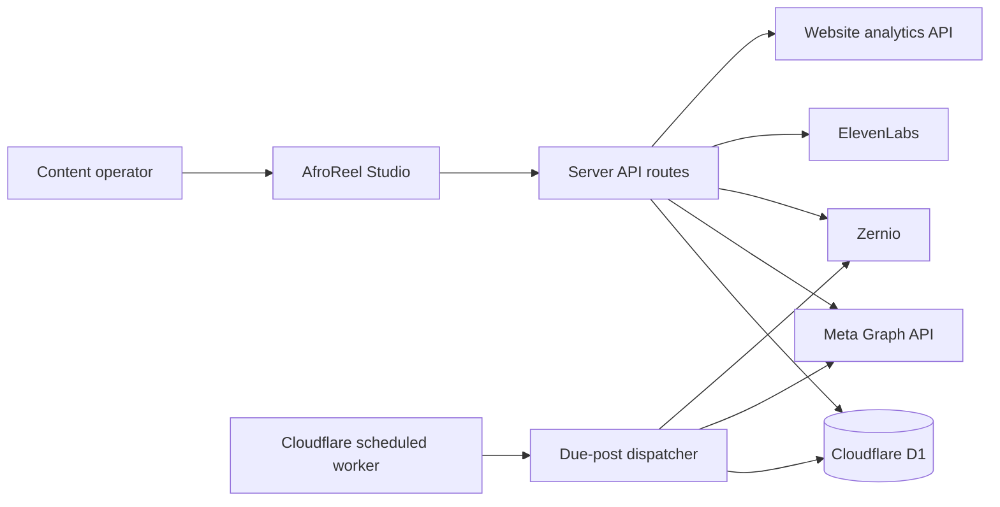

# Architecture

AfroReel Studio is a full-stack operations dashboard for five language workspaces: English, Zulu, Hausa, Swahili and French. The application uses a React interface with server routes deployed to Cloudflare, while D1 stores schedules, targets, connection state and post-production jobs.

## Main product areas

### Scheduling and publishing

Operators can create one post and provide platform-specific Facebook, Instagram, TikTok and YouTube copy. YouTube has separate title and description fields. Media can be supplied by direct URL, imported from Google Drive, or uploaded from the local computer. The interface supports previews, drafts, private dry runs, immediate publication and scheduled publication.

The scheduling layer stores a post separately from its platform targets. This makes retries and provider results auditable per destination. A Cloudflare scheduled handler checks for due targets every minute, locks work before dispatch and records success or failure so publishing continues when the operator's computer is offline.

### Provider adapters

Facebook and Instagram publish through the Meta Graph API. TikTok, YouTube and hosted media use Zernio. The application selects credentials and account IDs from the active language workspace and exposes readiness and diagnostic routes without returning secrets to the browser.

### Analytics and attribution

The dashboard combines provider metrics with website funnel data. It supports platform, language and date filters and models the path from video view to profile visit, tracked link click, site visit, episode watching and signup. The event contract is documented in [ANALYTICS_EVENT_SPEC.md](ANALYTICS_EVENT_SPEC.md).

### Post-production workflow

The production workspace tracks episode intake, ElevenLabs dubbing jobs, transcript comparison, translation review, music generation and media review. It deliberately keeps human approval gates for transcript meaning, dubbing and music instead of presenting paid generations as automatically correct. The longer-term packaging and Bunny handoff contract is documented in [POST_PRODUCTION_WORKFLOW.md](POST_PRODUCTION_WORKFLOW.md).

## Reliability decisions

- Credentials stay in server-side deployment secrets.
- Scheduled targets have independent state and provider responses.
- Dry runs validate configuration without creating public posts.
- Media URLs are normalized and checked before provider dispatch.
- API routes return explicit readiness and diagnostic results.
- Post-production jobs retain project and language identifiers for retry and audit.
- TypeScript validation and a production build run in GitHub Actions.

## Repository map

| Path | Responsibility |
| --- | --- |
| `app/page.tsx` | Main dashboard and navigation |
| `app/api/posts` | Post persistence and retrieval |
| `app/api/publish` | Planning, readiness, dispatch and due-post execution |
| `app/api/meta` | Meta accounts, diagnostics, publishing and insights |
| `app/api/production` | Dubbing, transcript QA, translation QA, music and media review |
| `components/production-workflow.tsx` | Guided post-production interface |
| `components/*analytics.tsx` | Social and website funnel reporting |
| `lib/publishing.ts` | Provider-aware publishing functions |
| `lib/dispatch.ts` | Target dispatch orchestration |
| `db/schema.ts` and `drizzle/` | D1 data model and migration |
| `scripts/add-scheduler.mjs` | Adds the Cloudflare scheduled handler to the build |

## Scope and limits

This repository contains the application source and database schema. Live account credentials, deployment ownership, production media and customer data are intentionally excluded. A new deployment needs its own provider credentials and Cloudflare bindings.
